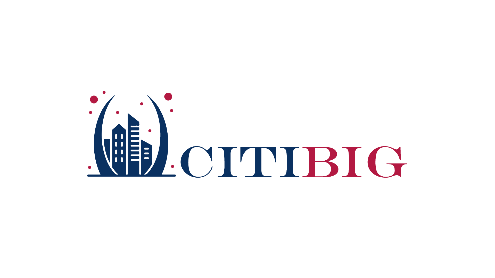

<div class="cover-hero">
  
  <h1 class="cover-title">مستندات دروازه سرویس CITIBIG</h1>
  <p class="cover-sub">DOC-GATEWAY-CITIBIG — مستندات فنی رسمی دروازه API سازمانی (APISIX)</p>
  <div class="cover-badges">
    <span class="badge">نسخه مستندات: اکتبر ۲۰۲۶</span>
    <span class="badge">APISIX 3.17.0</span>
    <span class="badge">لایسنس: GPL-3.0</span>
    <span class="badge">وضعیت: فعال — Production</span>
    <span class="badge">طبقه‌بندی: محرمانه — استفاده داخلی</span>
  </div>
</div>

---

## معرفی پروژه

**CITIBIG Gateway** دروازهٔ یکپارچهٔ API سازمانی است که تمام ارائه‌دهنده‌های خدمات وب (Zohal، api.ir، Ehraz، سرویس‌های Media و Movtihouse) را پشت **یک نقطهٔ ورود واحد** جمع می‌کند. این دروازه بر بستر **Apache APISIX 3.17.0** اجرا می‌شود و وظیفهٔ احراز هویت، بازنویسی مسیر، تزریق خودکار توکن‌ها و مسیریابی به بک‌اندها را بر عهده دارد.

- کلاینت‌ها فقط با هدر `apikey` گیت‌وی احراز می‌شوند؛ توکن واقعی هر ارائه‌دهنده به‌صورت خودکار تزریق می‌شود.
- مسیر هر سرویس آینهٔ مسیر بک‌اند است و مسیر گیت‌وی ثابت و مستند شده است.
- مدیریت کامل از طریق **Admin API** (پورت 8005) انجام می‌شود.

## اطلاعات اتصال سریع

| مورد | مقدار |
|---|---|
| Data-plane (پروکسی) | `http://2.144.22.190:9080` |
| Admin API | `http://2.144.22.190: پورت 8005` |
| پیشوندهای مسیر | `/services/` (Zohal) · `/apiir/` (api.ir) · `/ehraz/` (Ehraz) |
| تعداد کل روت‌ها | ۱۴۳ روت + ۳ روت مستقل |
| هدر احراز گیت‌وی | `apikey: <کلید مربوطه>` |

## فهرست مستندات

| # | مستند | شرح | لینک |
|---|---|---|---|
| ۱ | [داکیومنت جامع CITIBIG-GATEWAY](#/doc/citibig-gateway-apisix-docs) | معماری ادغام‌شده، کلیدها، مدیریت و عیب‌یابی کلی | ← |
| ۲ | [داکیومنت سرویس api.ir](#/doc/apiir-apisix-docs) | ۶۷ وب‌سرویس api.ir روی گیت‌وی | ← |
| ۳ | [داکیومنت سرویس Ehraz](#/doc/ehraz-apisix-docs) | ۳۳ وب‌سرویس ehraz.io روی گیت‌وی | ← |
| ۴ | [برگهٔ تقلب APISIX + PostgREST](#/doc/APISIX_CHEATSHEET) | راهنمای سریع روت‌های Media و سینتکس فیلتر | ← |

## ساختار مخزن

```
DOC-GATEWAY-CITIBIG/
├── MDDOCS/                 ← پورتال مستندات (همین سایت)
│   ├── index.html          ← قالب شرکتی
│   ├── docs/               ← تک‌تک مستندات (Markdown)
│   └── assets/             ← لوگو، فونت، CSS/JS
├── deploy/nginx.conf       ← کانفیگ nginx کانتینر
├── Dockerfile              ← ایمیج مستندات
├── docker-compose.yml      ← اجرا با پورت قابل‌تنظیم
├── .env.example            ← نمونهٔ تنظیمات (DOCS_PORT)
├── .github/workflows/      ← سینک خودکار به GitLab (hamgit.ir)
└── LICENSE                 ← GNU GPL v3
```

## حق نشر و لایسنس

<div class="copyright-box">
<p><strong>© ۲۰۲۶ CITIBIG — تمام حقوق محفوظ است.</strong></p>
<p>این مستندات و پورتال نمایش آن‌ها («DOC-GATEWAY-CITIBIG») توسط تیم <strong>tahavey18</strong> تهیه و نگهداری می‌شود.</p>
<p>این اثر تحت لایسنس <a href="https://www.gnu.org/licenses/gpl-3.0.html" target="_blank" rel="noopener">GNU General Public License v3.0</a> منتشر شده است؛ اجازهٔ کپی، مطالعه، تغییر و بازنشر مشروط به رعایت همان لایسنس داده می‌شود. متن کامل لایسنس در فایل <code>LICENSE</code> ریشهٔ مخزن موجود است.</p>
<p>نام و لوگوی CITIBIG متعلق به مالک برند است و استفاده از آن خارج از این پروژه مجاز نیست.</p>
</div>

> 📌 **نکتهٔ محرمانگی:** در این مستندات کلیدهای واقعی سرویس‌ها درج شده است؛ این مخزن فقط باید در مخازن خصوصی (GitHub خصوصی و hamgit.ir خصوصی) نگهداری شود و در دسترس عموم قرار نگیرد.
