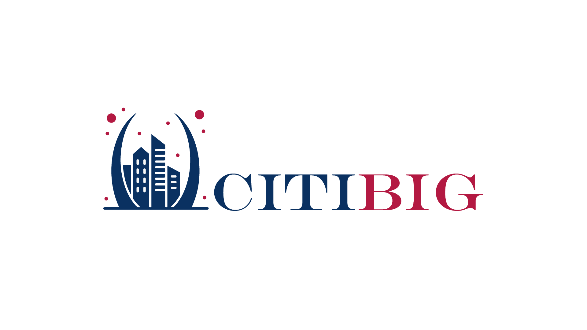

<div class="citibig-cover" markdown>

{ .citibig-logo }

# مستندات دروازه سرویس CITIBIG

**DOC-GATEWAY-CITIBIG** — مستندات فنی رسمی دروازهٔ یکپارچهٔ API سازمانی (Apache APISIX)

نسخهٔ مستندات: **اکتبر ۲۰۲۶** · APISIX **3.17.0** · لایسنس **GPL-3.0**

</div>

---

## معرفی پروژه

**CITIBIG Gateway** دروازهٔ یکپارچهٔ API سازمانی است که تمام ارائه‌دهنده‌های خدمات وب (Zohal، api.ir، Ehraz، سرویس‌های Media و Movtihouse) را پشت **یک نقطهٔ ورود واحد** جمع می‌کند. این دروازه بر بستر **Apache APISIX 3.17.0** اجرا می‌شود و وظیفهٔ احراز هویت، بازنویسی مسیر، تزریق خودکار توکن‌ها و مسیریابی به بک‌اندها را بر عهده دارد.

- کلاینت‌ها فقط با هدر `apikey` گیت‌وی احراز می‌شوند؛ توکن واقعی هر ارائه‌دهنده به‌صورت خودکار تزریق می‌شود.
- مسیر هر سرویس آینهٔ مسیر بک‌اند است و مسیر گیت‌وی ثابت و مستند شده است.
- مدیریت کامل از طریق **Admin API** (پورت 8005) انجام می‌شود.

## اطلاعات اتصال سریع

| مورد | مقدار |
|---|---|
| Data-plane (پروکسی) | `http://2.144.22.190:9080` |
| Admin API | `http://2.144.22.190:8005/apisix/admin` |
| پیشوندهای مسیر | `/services/` (Zohal) · `/apiir/` (api.ir) · `/ehraz/` (Ehraz) |
| تعداد کل روت‌ها | ۱۴۳ روت + ۳ روت مستقل |
| هدر احراز گیت‌وی | `apikey: <کلید مربوطه>` |

## فهرست مستندات

| # | مستند | شرح |
|---|---|---|
| ۱ | [داکیومنت جامع CITIBIG-GATEWAY](citibig-gateway-apisix-docs.md) | معماری ادغام‌شده، کلیدها، مدیریت و عیب‌یابی کلی |
| ۲ | [داکیومنت سرویس api.ir](apiir-apisix-docs.md) | ۶۷ وب‌سرویس api.ir روی گیت‌وی |
| ۳ | [داکیومنت سرویس Ehraz](ehraz-apisix-docs.md) | ۳۳ وب‌سرویس ehraz.io روی گیت‌وی |
| ۴ | [برگهٔ تقلب APISIX + PostgREST](APISIX_CHEATSHEET.md) | راهنمای سریع روت‌های Media و سینتکس فیلتر |
| ۵ | [لایسنس و حق نشر](license.md) | GPL-3.0 و کپی‌رایت |

## ساختار مخزن

```text
DOC-GATEWAY-CITIBIG/
├── MDDOCS/                  ← پروژهٔ MkDocs Material
│   ├── mkdocs.yml           ← کانفیگ (RTL فارسی، تم شرکتی)
│   ├── docs/                ← تک‌تک مستندات (Markdown)
│   └── docs/assets/         ← لوگو و فونت وزیرمتن
├── deploy/nginx.conf        ← کانفیگ nginx کانتینر (utf-8 + healthz)
├── Dockerfile               ← بیلد دو مرحله‌ای (mkdocs → nginx)
├── docker-compose.yml       ← اجرا با پورت قابل‌تنظیم (DOCS_PORT)
├── .env.example             ← نمونهٔ تنظیمات
├── .github/workflows/       ← سینک خودکار به hamgit.ir
└── LICENSE                  ← GNU GPL v3.0
```

## حق نشر و لایسنس

!!! note "کپی‌رایت"

    **© 2026 CITIBIG — تمام حقوق محفوظ است.**

    این مستندات و پورتال نمایش آن‌ها («DOC-GATEWAY-CITIBIG») توسط تیم **tahavey18** تهیه و نگهداری می‌شود و تحت لایسنس [GNU General Public License v3.0](https://www.gnu.org/licenses/gpl-3.0.html) منتشر شده است؛ اجازهٔ کپی، مطالعه، تغییر و بازنشر مشروط به رعایت همان لایسنس داده می‌شود. متن کامل لایسنس در فایل `LICENSE` ریشهٔ مخزن موجود است.

    نام و لوگوی CITIBIG متعلق به مالک برند است و استفاده از آن خارج از این پروژه مجاز نیست.

!!! warning "نکتهٔ محرمانگی"

    در این مستندات کلیدهای واقعی سرویس‌ها درج شده است؛ این مخزن فقط باید در مخازن خصوصی (GitHub خصوصی و hamgit.ir خصوصی) نگهداری شود و در دسترس عموم قرار نگیرد.
