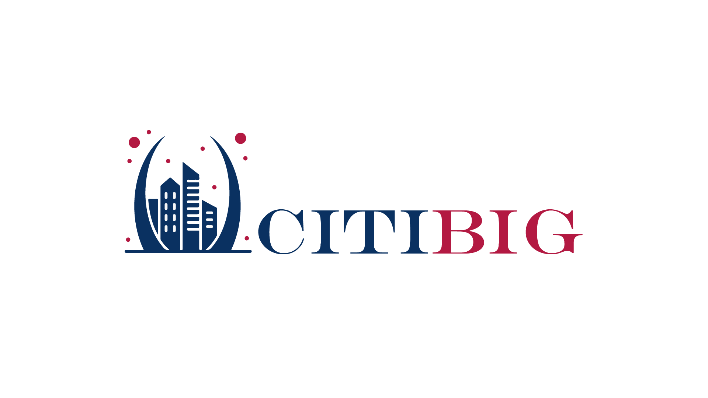

<div align="center">



# DOC-GATEWAY-CITIBIG

پورتال مستندات رسمی **CITIBIG API** — پلتفرم یکپارچهٔ سرویس‌های داده و استعلام، ساخته‌شده با MkDocs Material (راست‌به‌چپ، حالت شب/روز)، تحویل با داکر، آینه‌سازی به GitLab و انتشار خودکار.

[](LICENSE)
[](https://github.com/tahatehranin/DOC-GATEWAY-CITIBIG/releases)
[](https://github.com/tahatehranin/DOC-GATEWAY-CITIBIG/actions/workflows/release.yml)
[](https://github.com/tahatehranin/DOC-GATEWAY-CITIBIG/actions/workflows/sync-to-gitlab.yml)
[](https://squidfunk.github.io/mkdocs-material/)
[](#۲-اجرای-محلی-با-داکر)

**[English](README.md)** | **فارسی**

</div>

---

## دربارهٔ پروژه

این مخزن، پورتال مستندات رسمی **CITIBIG API** را نگه می‌دارد — پلتفرم یکپارچهٔ API برای سرویس‌های هویتی، بانکی، قبوض، مخابراتی، خودرو، کسب‌وکار، مکان و رسانه.

- مستندات مشتری‌محور: **۹ خانوادهٔ سرویس، ۱۴۳ اندپوینت** — هر اندپوینت با کرل آماده
- فارسی رسمی راست‌به‌چپ + پشتیبانی کامل کد (LTR)
- تم شرکتی (پالت سرمه‌ای/زرشکی، فونت وزیرمتن باندل‌شده، حالت شب/روز)
- بیلد سخت‌گیرانه (`mkdocs build --strict`) — لینک شکسته بیلد را متوقف می‌کند
- ایمیج داکر دو مرحله‌ای (بیلد → nginx) با پورت میزبان قابل‌تغییر

## ساختار پروژه

```
DOC-GATEWAY-CITIBIG/
├── MDDOCS/                  ← پروژهٔ MkDocs Material
│   ├── mkdocs.yml           ← کانفیگ (RTL فارسی، تم شرکتی، nav)
│   ├── docs/                ← تک‌تک مستندات (Markdown)
│   │   ├── index.md               ← صفحهٔ اول: کاور، ویژگی‌ها، کپی‌رایت
│   │   ├── getting-started.md     ← شروع سریع (تب‌های curl/Python/Node)
│   │   ├── authentication.md      ← احراز هویت
│   │   ├── errors.md              ← کدهای پاسخ و خطا
│   │   ├── license.md             ← حق نشر و لایسنس (کوتاه)
│   │   └── services/              ← مرجع ۹ خانوادهٔ سرویس
│   │       ├── identity.md / banking.md / bills.md
│   │       ├── telecom.md / vehicle.md / business.md
│   │       └── location.md / media.md / tools.md
│   └── docs/assets/         ← لوگو + فونت وزیرمتن (کاملاً آفلاین)
├── deploy/nginx.conf        ← کانفیگ nginx کانتینر (utf-8 + healthz)
├── Dockerfile               ← بیلد دو مرحله‌ای (mkdocs --strict → nginx)
├── docker-compose.yml       ← اجرا با DOCS_PORT قابل‌تنظیم (پیش‌فرض 3100)
├── .env.example             ← نمونهٔ تنظیمات
├── VERSION                  ← نسخهٔ فعلی (مبنای انتشار خودکار)
├── .github/workflows/       ← سینک GitLab + انتشار خودکار Release
└── LICENSE                  ← GNU GPL v3.0
```

## اجرای محلی با داکر

```bash
cp .env.example .env          # اختیاری — پورت پیش‌فرض 3100
docker compose up -d --build
# → http://localhost:3100
```

تغییر پورت (مثلاً 3101):

```bash
DOCS_PORT=3101 docker compose up -d
```

## پیش‌نمایش محلی (بدون داکر)

```bash
python -m pip install "mkdocs-material~=9.5"
python -m mkdocs serve        # از داخل پوشهٔ MDDOCS
# → http://localhost:8000
```

## استقرار در Dokploy

1. یک سرویس از نوع **Compose** بسازید و به این مخزن وصل کنید (GitHub یا آینهٔ GitLab).
2. Dokploy خودش `docker-compose.yml` را تشخیص می‌دهد؛ پورت کانتینر **80** است.
3. پورت میزبان را با متغیر محیطی `DOCS_PORT` تنظیم کنید (پیش‌فرض **3100**، قابل تغییر به 3101 و…).
4. Health check: `GET /healthz` (همیشه `ok` برمی‌گرداند).

## انتشار خودکار (Release)

نسخه‌گذاری مطابق [Semantic Versioning](https://semver.org) و تگ‌ها با قالب `vX.Y.Z`.

1. فایل `VERSION` را به‌روز کنید (مثلاً `1.0.1`) و پوش بزنید.
2. Workflow ی `release.yml` خودکار تگ `v1.0.1` و یک **GitHub Release** با یادداشت‌های خودکار می‌سازد.
3. یا دستی: تب **Actions → Release (tag + GitHub Release) → Run workflow** و شمارهٔ نسخه را وارد کنید.

> انتشار idempotent است — اگر تگ از قبل موجود باشد، رد می‌شود.


## افزودن مستند جدید

1. فایل `.md` را در `MDDOCS/docs/` (برای سرویس‌ها: `docs/services/`) بگذارید.
2. در بخش `nav:` فایل `MDDOCS/mkdocs.yml` ثبتش کنید.
3. با `mkdocs serve` پیش‌نمایش بگیرید و کامیت بزنید — بیلد strict سلامت لینک‌ها و جدول‌ها را تضمین می‌کند.

## نکات نگهداری

- در مستندات **کلیدهای واقعی سرویس‌ها** درج شده است — هر دو مخزن باید **خصوصی** بمانند.
- فونت، آیکون‌ها و لوگو داخل مخزن‌اند — سایت کاملاً آفلاین و بدون CDN کار می‌کند.
- بازسازی کامل ایمیج: `docker compose build --no-cache`.

## لایسنس

منتشرشده تحت [GNU GPL v3.0](LICENSE). © 2026 CITIBIG — تمام حقوق محفوظ است.
